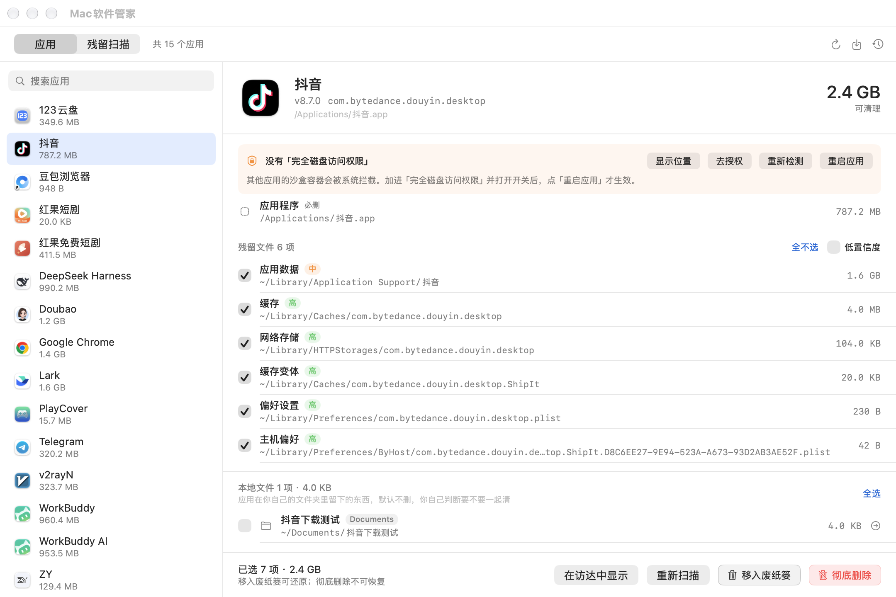
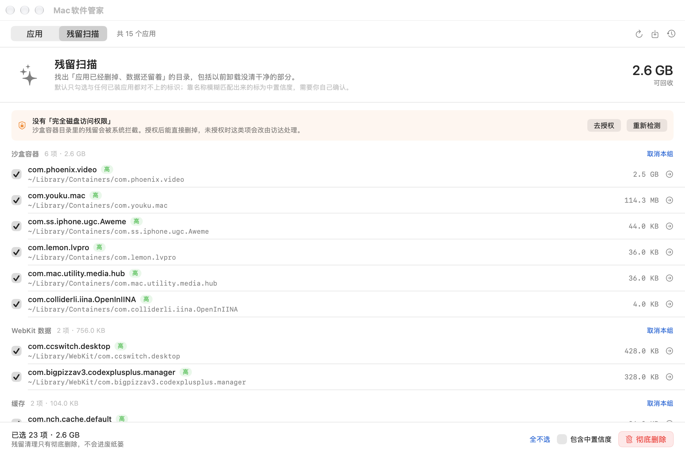
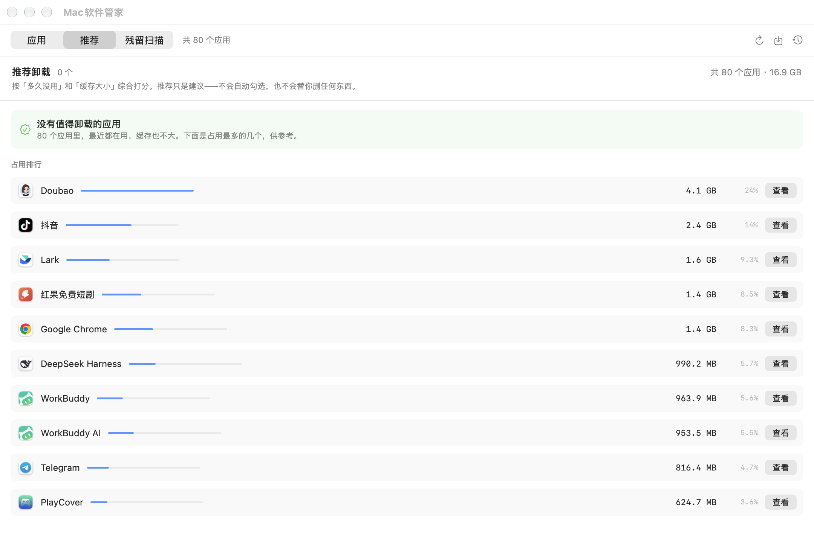

# Mac 软件管家

原生 macOS 应用，用来**可视化地安装和卸载软件**。左侧是已装应用列表，选中后列出它散落在系统各处的全部文件，勾选确认后一次性清理。

提供两种删除方式：**移入废纸篓**（可还原）和**彻底删除**（直接删掉，不留任何副本）。

顶部的「残留扫描」是另一条独立通道：不管应用是什么时候删的、用什么删的，只要数据还在、应用已经不在，就能一次扫出来清掉。

界面部分是独立的 Swift 实现，**运行时不需要 Python**。



## 安装

```sh
open "dist/Mac软件管家-1.3.dmg"
```

把 `Mac软件管家` 拖进 Applications 即可。已经做了 ad-hoc 签名，本机双击就能用。

## 能做什么

**卸载**：选应用 → 看清单 → 勾选 → 移入废纸篓 / 彻底删除

- 应用本体 + `~/Library` 下的数据、缓存、偏好、沙盒容器、登录项，一次列全
- 每条标置信度（高/中/低），低置信度的模糊匹配默认不勾选
- 移入废纸篓的可以随时还原；彻底删除的不留副本

**本地文件**：应用在你自己的文件夹里留下的东西，单独列一组让你决定

- 扫 `~/Documents`、`~/Desktop`、`~/Downloads`、`~/Movies`、`~/Music`、`~/Pictures` 的**一级条目**
- 命中方式：应用名、`.app` 文件名、可执行文件名、bundle id、bundle id 里的厂商名，做了归一化和分词，`抖音` 能命中 `抖音下载`，`Lark` 能命中 `larksuite-notes`
- **默认一律不勾选**，要你自己判断；安装包（dmg/pkg/zip/apk…）不算应用数据，直接跳过
- 勾了也**只会移入废纸篓**——哪怕你选的是「彻底删除」，本地文件也不会被永久删除，那是你自己的文档，留一条退路
- 这类路径本来在禁区里，所以专门加了一道更严的校验：只允许删用户文件夹下的一级条目，`~/Documents` 本身和它的子目录一律拒绝

**彻底删除**做了几层保护，不是随手一点就没了：

- 弹窗里必须勾选「我确认这些文件不再需要」才能点确认
- 标题和副标题都明确写「不进入废纸篓，删除后无法恢复」
- 仍然走同一套路径白名单校验，`/System`、`~/Documents` 这类禁区照旧拒绝
- 顺带清理 pkg 安装收据（`pkgutil --forget`），不留孤儿记录
- `/Library` 下的守护进程、特权助手会单独询问是否用管理员权限一并清掉

**安装**：点右上角下载图标，或把文件直接拖进窗口

- 支持 `.dmg`（自动挂载→复制→卸载卷）、`.zip`、`.app`、`.pkg`（走系统安装器，需要授权）
- 目标位置已有同名应用时，旧版本先进废纸篓，可还原

**还原**：右上角时钟图标 → 每次「移入废纸篓」都有记录 → 一键搬回原位置。彻底删除的记录会标注「已彻底删除，不可还原」。

**残留扫描**：顶部切到「残留扫描」→ 自动扫描 → 勾选 → 彻底删除

扫的是「应用已经不在，数据还留着」的目录，跟具体哪个应用无关，所以以前用别的工具没删干净的、直接拖进废纸篓的、很久以前就删掉的，全都在这一张表里。

覆盖 10 个位置：`Containers`、`Group Containers`、`Application Support`、`Caches`、`HTTPStorages`、`WebKit`、`Saved Application State`、`Logs`、`LaunchAgents`、`Preferences`。

判定规则是「宁可漏报，不可错杀」：

| 目录名形态                | 判定方式                          | 置信度       |
| -------------------- | ----------------------------- | --------- |
| `com.foo.bar`（三段以上反向域名） | 精确比对**全盘**已安装应用的 bundle id | 高，默认勾选    |
| `com.foo`（两段）        | 同上，但两段可能只是厂商共享目录或普通文件名        | 中，需手动勾选   |
| 同厂商的兄弟组件             | 装着 `com.google.Chrome` 时，`com.google.GoogleUpdater` 这类很可能还在服役 | 中，需手动勾选   |
| 超过 200 MB 的容器        | 真卸干净的容器通常只有几十 KB，这么大说明应用还在用     | 中，需手动勾选   |
| `优酷`、`LarkShell` 等自然语言名 | 与应用名、文件名、名字里的词、bundle id 里的厂商名做归一化模糊匹配 | 中，需手动勾选   |
| `com.apple.*`、`systemgroup.*`、`iCloud.*` 等 | 一律跳过                          | —         |

「已安装应用」不是只看 `/Applications`，而是用 Spotlight 索引全盘找所有 `.app`（`mdfind`），所以装在 iCloud Drive、`~/Documents`、任意目录的应用也能认出来。Group Containers 会先剥掉团队 ID 前缀（`5A4RE8SF68.com.tencent.xinWeChat` → `com.tencent.xinWeChat`）再判定。

顺带排除了一批不是应用但删了会麻烦的目录（`SwiftPM` 缓存、`ByHost`、`GeoServices`、`PassKit`、`DiagnosticReports`、`Homebrew`、`CloudKit` 等），以及本应用自己的偏好设置。

清理时**默认移入废纸篓**（可还原），彻底删除需要额外勾选一次确认；选中的项里有超过 500 MB 的，弹窗会单独用橙色标出来。



## 推荐卸载与占用分析（v1.4）

顶部切到「推荐」→ 按分数排序的清单，每条写明理由。



上图是「没有值得卸载的应用」时的样子：页面回退成占用排行，不至于是个空页。这台机器上 80 个应用最近都在用、缓存也不大，所以一条推荐都没有——这本身就是正确结果。

**打分规则**（纯函数 `RecommendationEngine.evaluate`，不碰磁盘，自检里逐个用例验证）：

| 维度 | 加分 |
| --- | --- |
| 超过一年没打开 | +45 |
| 半年多没打开 | +32 |
| 三个月没打开 | +20 |
| 两个月没打开 | +10 |
| 缓存 ≥ 5 GB / ≥ 1 GB / ≥ 500 MB | +25 / +15 / +7 |
| 本体 ≥ 2 GB / ≥ 1 GB | +15 / +8 |
| 数据 ≥ 1 GB 且是本体 3 倍以上 | +10 |

≥ 50 分是「推荐卸载」，≥ 25 分是「可以考虑」。另外两条硬规则：

- **系统软件永不推荐**，直接排除
- **最近 30 天用过的**，除非缓存超过 5 GB，否则不推荐

推荐只是建议。它不会自动勾选任何东西，也不会替你删任何东西——点「查看」进到卸载清单，勾什么还是你自己决定。

### 「最后使用时间」是三路拼的

macOS 没有「应用上次启动时间」的公开接口。实测全盘 338 个 `.app`：

| 来源 | 实现 | 覆盖率 | 界面标注 |
| --- | --- | --- | --- |
| Spotlight | `NSMetadataItem` 读 `kMDItemLastUsedDate` | 28/338（8%） | 系统记录 |
| 数据活跃 | 应用数据目录（容器/缓存/偏好/保存状态）最新 mtime，只看目录本身 + 第一层子项 | 约一半 | 数据活跃 |
| 安装时间 | `.app` 本体 mtime | 全部 | 仅安装时间 |

Safari、Music 这些系统应用的 `kMDItemLastUsedDate` 是 `null`——它们不走 LaunchServices 常规启动。所以必须有兜底。

**标着「仅安装时间」的应用不参与「多久没用」的判断**，因为那个时间只说明什么时候装的。

### 系统软件怎么认

三个信号取并集：

1. 解析符号链接后落在 `/System` 或 `/Library/Apple`。`/Applications/Safari.app` 其实是指向 `../System/Cryptexes/App/System/Applications/Safari.app` 的链接，只看字面路径会漏
2. bundle id 以 `com.apple.` 开头
3. Apple 平台签名：叶子证书 subject 是 `macOS Software Signing`（第三方是 `Developer ID Application: <公司> (<团队 ID>)`）

签名判定走进程内 `SecStaticCodeCreateWithPath` + `SecCodeCopySigningInformation`，338 个应用 1.1 秒；换 `codesign` 子进程要 7.4 秒，没法用在刷新流程里。

系统软件在侧边栏单独分组（默认折叠），详情页只展示占用，卸载按钮替换成「系统自带，不可卸载」。

### 体积怎么拆

| 字段 | 范围 |
| --- | --- |
| 本体 | `.app` 包 |
| 数据 | `~/Library/Containers/<bid>`、`Application Support/<bid 或名字>`、`Preferences/<bid>.plist`、`Saved Application State`、`HTTPStorages`、`WebKit` |
| 缓存 | `~/Library/Caches/<bid 或名字>`、Group Containers 里的 `Library/Caches` |

沙盒容器内部的 `Data/Library/Caches` 算进「数据」，不重复计进「缓存」。

刷新分两阶段：先算体积让界面立刻可用，再在后台补画像，每 25 个推一次进度。调试用 `--recommend` 可以把每个应用的画像和分数打出来。

## 关于沙盒容器（TCC 拦截）

其他应用的沙盒数据（`~/Library/Containers/xxx`、`~/Library/Group Containers/xxx`）受 macOS 的 TCC 保护，普通应用去删会被内核拒绝，报「你没有访问该诊断报告的许可」。

**这不是文件权限问题，所以 `sudo` 一般也删不掉** —— TCC 是按发起进程判定的，root 一样要过这道闸。

三条可行路线，按推荐程度排序：

1. **授予完全磁盘访问权限**（官方做法，一劳永逸）  
   系统设置 → 隐私与安全性 → 完全磁盘访问权限 → 加入「Mac软件管家」并打开开关 → 点界面上的「重启应用」。  
   授权后 `removeItem` 就能直接删除，连访达都不用请。
2. **让访达代删**（不用授权 FDA，但会弹一次「允许控制访达」）  
   访达本身在系统白名单里，能删掉别的应用的容器。应用内置了这条兜底通道：直接删除被系统拒绝时，会自动改请访达移入废纸篓。清空废纸篓即彻底清除。
3. **终端手动处理**（一次性、适合收尾）  
   给终端授予完全磁盘访问权限后执行 `rm -rf`，或直接在访达里把目录拖进废纸篓。

### 授权为什么老是「不生效」

v1.2 之前这里有个真 bug，也是三个最容易踩的坑：

| 坑 | 现象 | 怎么解决 |
| --- | --- | --- |
| **探测路径写错了**（v1.2 已修） | 旧版拿 `~/Library/Application Support/com.apple.TCC/TCC.db` 当探针，而这个文件在新版 macOS 上根本不存在 → 无论怎么授权都显示未授权 | v1.2 改成多路探测真实受保护位置（Safari 容器、`~/Library/Mail` 等），读到任意一个就判定已授权；三个状态 `已授权 / 被拒绝 / 无法判断`，不确定时不再吓唬人 |
| **TCC 判定按进程缓存** | 授权后点「重新检测」还是拒绝 | 必须重启进程。界面上有「重启应用」按钮，点了自动退出重开 |
| **从 dmg 里直接运行** | 系统把应用「传送」到 `/private/var/folders/.../AppTranslocation/` 随机路径，每次启动路径都变，授权永远留不住 | 先把应用拖进「应用程序」文件夹。应用能识别这种情况并直接提示 |

另外：本应用是 ad-hoc 签名，**换新版本后签名变了，旧的授权记录可能失效**。如果列表里开关看着是开的但仍提示未授权，把它从列表里 `−` 删掉，再重新 `+` 加一次。

界面上会在检测到权限被拒时显示提示条，带「显示位置 / 去授权 / 重新检测 / 重启应用」四个按钮。「显示位置」会在访达里选中应用，可以直接拖进授权列表。

## 一次真实事故复盘（v1.3 修复）

2026-10-21 21:27，残留扫描误判微信的沙盒容器为"孤儿目录"，用户全选后彻底删除，**12.08 GB 微信本地数据被永久删除**，微信退出登录。

三个漏洞叠在一起才出事：

1. **应用发现只扫了两个目录**（`/Applications`、`~/Applications`）。微信装在 `~/Library/Mobile Documents/iCloud~is~workflow~my~workflows/Documents/WeChat.app`（iCloud Drive 里），扫描器认为"微信没装"，于是 `~/Library/Containers/com.tencent.xinWeChat` 就成了孤儿。→ 改为 Spotlight 全盘索引，bundle id 从 15 个涨到 327 个。
2. **Group Containers 的团队 ID 前缀没处理**。`5A4RE8SF68.com.tencent.xinWeChat`、`243LU875E5.groups.com.apple.podcasts` 都认不出来，连 Apple 自家的容器都被列成残留。→ 剥掉 10 位团队 ID 和 `group.`/`groups.` 前缀再判定。
3. **没有体积红线，且清理只有"彻底删除"一条路**。12 GB 的目录和 4 KB 的空壳在界面上长得一样，点两下就没了，还不进废纸篓。→ 超过 200 MB 的容器强制降为中置信度；清理默认移入废纸篓，彻底删除要额外勾选；超过 500 MB 的项单独高亮警告。

教训很直白：**"残留"这个判断一旦错了，代价是不可逆的**。所以现在的原则是「宁可漏报，不可错杀」，并且默认留退路。

## 安全设计

| 机制       | 说明                                                                                                      |
| -------- | ------------------------------------------------------------------------------------------------------- |
| 默认可恢复    | 「移入废纸篓」用系统 `trashItem` API，支持访达「放回原处」                                                                   |
| 可还原      | 每次卸载写 manifest 到 `~/.macapp/history/`，与命令行版格式一致，两个工具可以互相还原                                              |
| 白名单      | 只在 `/Applications`、`~/Applications`、`~/Library` 若干子目录内操作                                                |
| 禁区       | `/System`、`/usr`、`/etc`、`~/Documents`、`~/Desktop`、`~/Downloads`、`~/.ssh`、`~/Library/Keychains` 等，任何情况不碰 |
| 共享目录只删子项 | `~/Library/Application Support` 本身永不删除                                                                  |
| 本地文件只进废纸篓 | 用户文档永远不会被彻底删除，且只允许动用户文件夹下的一级条目                                                       |
| 残留默认进废纸篓 | 清理残留默认移入废纸篓，彻底删除需二次勾选；超过 500 MB 的项单独警告                                              |
| 先预检再动手   | 废纸篓不可写就整体中止，一个文件都不动                                                                                     |
| 失败即停     | 应用本体删不掉就中止，不继续碰残留                                                                                       |

## 从源码构建

```sh
./build.sh      # 输出 dist/Mac软件管家.app
./package.sh    # 输出 dist/Mac软件管家-1.3.dmg
```

需要 macOS 14+ 与命令行工具。注意：**macOS 27 SDK 里的 SwiftUI 把 `@State` 等属性包装器改成了宏**，而命令行工具不附带 `SwiftUIMacros` 插件，直接编译会报 `external macro implementation type 'SwiftUIMacros.StateMacro' could not be found`。所以 `build.sh` 固定使用 `MacOSX26.5.sdk`：

```
-sdk /Library/Developer/CommandLineTools/SDKs/MacOSX26.5.sdk -target arm64-apple-macos14.0
```

装了完整 Xcode 之后可以去掉这两个参数。

## 自检

```sh
"dist/Mac软件管家.app/Contents/MacOS/MacApp" --selftest
```

覆盖 19 条路径安全用例、通配符匹配、应用发现、扫描结果合法性、废纸篓移入与还原往返、彻底删除（含禁区拒绝、废纸篓无残留）、残留判定（精确/厂商父级/厂商兄弟/系统目录/模糊名称）、残留扫描结果合法性、本地文件校验与名称匹配、权限探测、推荐引擎打分、占比与百分比格式、系统软件识别、应用画像与系统/自装分组，共 344 项。

想人工核对扫描结果（看有没有误报）可以直接列出来：

```sh
... --orphans        # 只看高置信度
... --orphans all    # 连中置信度一起看
... --recommend      # 每个应用的画像与推荐分数，调阈值用
```

开发期自查用的隐藏模式：

```sh
# 窗口截图（不需要屏幕录制权限）
... --snapshot /tmp/ui.png 抖音

# 离屏渲染详情页，绕过窗口合成
... --render /tmp/detail.png 抖音

# 渲染「彻底删除」确认弹窗
... --render-perm /tmp/perm.png 抖音

# 残留扫描界面（第二个参数传 orphan-all 可带出中置信度）
... --snapshot-orphan /tmp/orphan.png
... --snapshot-orphan /tmp/orphan.png orphan-all

# 推荐页（recommend-demo 用合成数据，方便检查推荐行排版）
... --snapshot-orphan /tmp/rec.png recommend
... --snapshot-orphan /tmp/rec.png recommend-demo

# 侧边栏默认折叠系统软件，这个参数展开它
... --snapshot /tmp/ui.png 抖音 --expand-system
```

注：`ImageRenderer` 不会给 `ScrollView` 里的内容排版，所以带列表的弹窗要用开窗截图（`--snapshot-orphan-sheet`）才看得全。

## 已知限制

- 只构建了 arm64，Intel Mac 需要改 `build.sh` 里的 target
- 「最后使用时间」是三路拼出来的，不是系统记录。标着「仅安装时间」的那批应用，其实不知道你到底用没用过，所以它们不参与推荐判断
- 缓存只统计 `~/Library/Caches` 与 Group Containers 里的 `Library/Caches`。应用自己塞进 `Application Support` 的数据算「数据」，不算「缓存」
- 系统软件按「`/System` 路径 + `com.apple.` 前缀 + Apple 平台签名」判定。极端情况：开发者用 Apple 证书签的第三方应用会被当成系统软件——不会被推荐卸载，但也删不掉
- 本地文件只按名字匹配。中文名和英文目录名对不上时会漏，比如 123云盘（`com.mac123.mfy`）在 `~/Downloads/123pan` 的目录就匹配不到
- 「残留」终究是猜的。Spotlight 没索引到的应用（比如刚从外置盘拔掉的）仍可能被误判，所以清理默认走废纸篓，别跳过
- 没有代码签名证书，分发给别人会触发 Gatekeeper 提示，需要右键→打开；而且每次重新构建签名都会变，旧的 TCC 授权可能失效
